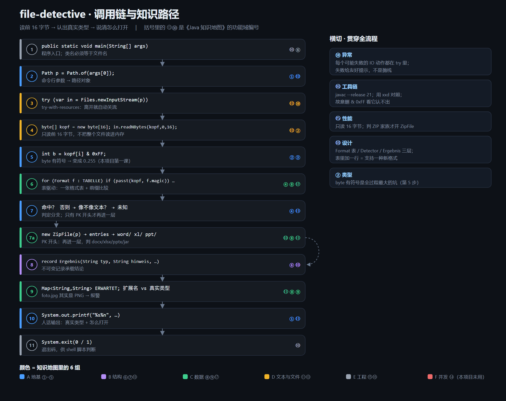

# file-detective · 项目拆分与知识路径

> 写于 2026-11-18。这是动手之前的"图纸"：拆成几个里程碑、每个里程碑要做到哪、用到《Java 知识地图》的哪些功能域、它们怎么串起来。
> 配套图：[知识路径图.png](知识路径图.png)（矢量版 [.svg](知识路径图.svg)）

---

## 0. 先说顺序：先项目二，再项目一

| 顺序 | 项目 | 为什么 |
|---|---|---|
| **① 现在** | `file-detective`（文件类型侦探） | 有唯一正确答案（魔数对就是对了）、40 行能跑出结果、`& 0xFF` 是字节操作的地基 |
| **② 之后** | `mojibake-fixer`（乱码修复） | 需要"字节 + 编码"两层、要打分排序（没有唯一答案）、且要先有字节直觉 |

**理由链**：项目二教的三件事（读字节、`byte→int`、用一张表做判定）项目一全要用；反过来不成立。

---

## 1. 拆成四个里程碑

| 里程碑 | 版本 | 这一版只做什么 | 验收（跑出来看到什么） | 耗时 |
|---|---|---|---|---|
| **M1 认出来** | v0.1 | 读前 16 字节 + 8 种格式的魔数表 + 打印真实类型 | 四个样例文件全认对；故意删掉 `& 0xFF` 后 PNG 认不出 | 40 min |
| **M2 说清楚** | v0.2 | 加"扩展名 vs 真实类型"比对 + "怎么打开"建议 + 退出码 | `foto.jpg`（实际是 PNG）会报警；每种类型有一句人话建议 | 1 h |
| **M3 再进一层** | v0.3 | ZIP 家族细分（docx/xlsx/pptx/jar/apk）+ 二进制/文本判定 | `.docx` 报 Word 文档而不是 ZIP；纯文本文件报"文本" | 1.5 h |
| **M4 能交付** | v1.0 | README 四段 + `samples/` 5 个样例 + 期望输出 + LICENSE + Actions 编译 | 别人 clone 下来照着 README 三行命令能跑通 | 1.5 h |

**每个里程碑都必须"能跑、能演示"**，不做"写了一半再一起测"。

## 2. 现在做到哪：M1 + M2

今天的目标只有 M1，然后立刻接 M2——因为 **M1 单独存在没有意义**（"这是个 PNG" 谁都会说），**M2 的"扩展名骗人"才是这个项目的价值**。

M1 完成标准（四条全绿才算过）：

1. `EIP.pdf` → PDF
2. `WordNet_bat.png` → PNG
3. `05_Praktikum 1.zip` → ZIP
4. `Analysebaum_1.jpg` → JPEG

## 3. 以后还能补什么（不用现在做）

| 想法 | 价值 | 难度 |
|---|---|---|
| 一次扫整个目录（`Files.walk`）出统计报告 | 高（真的会用） | 中 |
| `--json` 输出，方便别的程序调用 | 中 | 低 |
| 识别更多格式（7z/rar/webp/heic/mp4/wav/ttf） | 中 | 低（表加行） |
| 校验文件是否**损坏**（PDF 尾 `%%EOF`、PNG 尾 `IEND`） | 高 | 中 |
| 和 `mojibake-fixer` 联动：检测到文本就顺手判编码 | 高（两项目合体） | 中 |
| 拖拽 GUI（JavaFX） | 低（课程不教，容易跑偏） | 高 |

**判断标准**：能写进 README 当"特性"的才做；只是自己玩玩的，留在分支上别合并。

---

## 4. 知识路径图



读法：**左边竖着读是"程序从头到尾的执行顺序"**，每个框右侧的 ⑬⑩ 是《Java 知识地图》的功能域编号；**右边是横切关注点**（不属于某一步，而是贯穿全过程）；**颜色是 6 组**（A 地基 / B 结构 / C 数据 / D 文本与文件 / E 工程 / F 并发）。

## 5. 十二步调用链（每步：代码 → 域 → 为什么在这）

| # | 代码 | 域 | 这一步在解决什么 |
|---|---|---|---|
| 1 | `public static void main(String[] args)` | ⑯ ⑥ | 入口；类名必须等于文件名（`FileDetective.java`） |
| 2 | `Path p = Path.of(args[0]);` | ① ⑬ | 命令行参数变成路径对象；没传参数要提示用法 |
| 3 | `try (var in = Files.newInputStream(p))` | ⑬ ⑩ | try-with-resources：块结束自动关流，Windows 上不关会被锁 |
| 4 | `byte[] kopf = new byte[16]; in.readNBytes(kopf,0,16);` | ⑬ ② | 只读头部 16 字节——**不整读文件**（1 GB 的视频也只读 16 字节） |
| 5 | `int b = kopf[i] & 0xFF;` | ② ③ | **本项目第一课**：`byte` 有符号，`0x89` 存成 -119，必须 `& 0xFF` 变 0..255 |
| 6 | `for (Format f : TABELLE) if (passt(kopf, f.magic))` | ④ ⑧ ⑰ | 表驱动 + 前缀比较；加一种格式 = 表里加一行 |
| 7 | 命中？否则 → 像不像文本？→ 未知 | ④ ⑪ | 三条出口：认出来了 / 认不出但像文本 / 完全未知 |
| 7a | `new ZipFile(p) → entries → word/ xl/ ppt/` | ⑬ ⑧ ⑪ | **只在魔数 = `50 4B 03 04` 时走**：docx/xlsx/pptx/jar 全是 ZIP 换马甲 |
| 8 | `record Ergebnis(String typ, String hinweis, …)` | ⑥ ⑱ | 用不可变记录承载结论，避免"传五个参数" |
| 9 | `Map<String,String> ERWARTET;` 扩展名 vs 真实类型 | ⑪ ⑧ ⑨ | 取扩展名（`lastIndexOf('.')`+小写）→ 查期望类型 → 不符就报警 |
| 10 | `System.out.printf("%s%n", …)` | ① ⑪ | 人话输出：真实类型 + 为什么 + 怎么打开 |
| 11 | `System.exit(0 / 1)` | ⑯ | 退出码：认得=0，认不得=1，方便脚本串联 |

## 6. 域 × 里程碑 矩阵（● 必用 · ○ 可选 · 空 = 不涉及）

| 域 | M1 | M2 | M3 | M4 | 在这个项目里的角色 |
|---|---|---|---|---|---|
| ① 输入输出与交互 | ● | ● | ● | ● | 命令行参数、`printf` 输出 |
| ② 类型与数据表示 | ● | ● | ● | ● | `byte` 有符号、`& 0xFF`、`byte[]` vs `int` |
| ③ 运算与表达式 | ● | ● | ● | ● | 位与、比较、索引 |
| ④ 控制流 | ● | ● | ● | ● | 循环比表、三叉分支 |
| ⑤ 方法与递归 | ● | ● | ● | ● | `passt()` / `liesKopf()` 拆函数 |
| ⑥ 类与对象 | ○ | ● | ● | ● | `record Format` / `record Ergebnis` |
| ⑦ 继承·接口·多态 |  | ○ | ○ | ○ | 可选：`interface Detector` 让格式各自判断 |
| ⑧ 集合与容器 | ● | ● | ● | ● | `List<Format>` 表、`Map` 期望类型、`Set` zip 条目 |
| ⑨ 泛型与类型系统 | ● | ● | ○ | ○ | `List<Format>`、`Map<String,String>` |
| ⑩ 异常与资源管理 | ● | ● | ● | ● | try-with-resources、文件不存在、坏 zip |
| ⑪ 文本与字符串 | ○ | ● | ● | ● | 扩展名解析、`startsWith`、`endsWith`、格式化输出 |
| ⑫ 函数式与 Stream |  | ○ | ○ | ○ | 可选：`entries.stream().anyMatch(...)` |
| ⑬ 文件与持久化 | ● | ● | ● | ● | `newInputStream` / `readNBytes` / `ZipFile` |
| ⑭ 并发与线程 |  |  |  |  | **本项目不用**（单文件检测没有并发价值） |
| ⑮ 内存·JVM·性能 | ○ |  | ○ | ○ | 只读 16 字节就是性能设计 |
| ⑯ 工具链·测试·调试 | ● | ● | ● | ● | javac 参数、样例对照、Actions 编译 |
| ⑰ 数据结构与算法 | ● | ○ | ● | ● | 前缀匹配 O(k)、zip 条目集合查找 |
| ⑱ 设计与建模 | ○ | ● | ● | ● | 三层结构：表 / 检测器 / 结果 |

**统计：18 域里用到 17 个，只有 ⑭并发 不用。** 这就是它适合当第一个项目的原因——一个 200 行的程序，几乎把语言核心全过一遍。

## 7. 域是怎么"组合"起来的：三种关系

### ① 依赖（A 必须在 B 之前）

```
② 类型 ──→ ⑬ 文件 ──→ ⑧ 集合 ──→ ⑪ 文本
   byte      读字节      存表        拼输出
```

第 5 步不先做 `& 0xFF`，第 6 步的 `passt()` 就永远返回 false，第 7 步永远走"未知"，第 10 步输出全是"认不出来"。**依赖关系一旦断，症状出现在很远的下游** —— 这也是为什么新手总在错误的地方找 bug。

### ② 协作（同级配合，缺一不可）

| 组合 | 单独做会怎样 | 一起做才有 |
|---|---|---|
| ⑬文件 + ⑧集合 | 只会读一个文件 | 读 → 查表 → 判定 |
| ⑩异常 + ⑬文件 | 文件不存在直接崩 | 崩不了，给提示 |
| ⑥记录 + ⑱设计 | 一堆散变量传来传去 | `Ergebnis` 一个对象说清结论 |
| ⑪文本 + ⑧集合 | 扩展名比不了 | `Map` 查"`.pdf` 应该是什么" |

### ③ 横切（不在某一步，但整条链都受它约束）

| 横切域 | 怎么体现 |
|---|---|
| ⑩ 异常 | 第 2–4、7a、9 步都可能抛，全在 `try` 里；`main` 声明 `throws IOException` 也行，但要给用户友好提示 |
| ⑯ 工具链 | `javac --release 21 -encoding UTF-8`；改完必须重编译；Actions 里自动编译 |
| ⑮ 性能 | "只读 16 字节"是设计决策，写在 README 里 |
| ⑱ 设计 | 表里加一行就多支持一种格式 —— 这是"可扩展"的具体含义 |

**一句话**：**⑬文件 是入口，②类型 是地基，⑧集合 是中枢，⑱设计 是骨架，⑩异常 是保险，⑯工具链 是交付。**

## 8. 自测清单（每个里程碑自己打勾）

**M1**
- [ ] 四个样例文件全认对
- [ ] 删掉 `& 0xFF` 后 PNG 认不出（证明你真的理解了有符号 byte）
- [ ] 传一个不存在的路径，程序不崩、给出提示
- [ ] 传一个纯文本 `.txt`，输出"认不出来（可能是文本）"

**M2**
- [ ] 把 `WordNet_bat.png` 改名成 `fake.jpg`，程序报"扩展名与内容不符"
- [ ] 每种类型都有一句"怎么打开"
- [ ] 正常文件退出码 0，未知文件退出码 1

**M3**
- [ ] 随便找个 `.docx`（没有就新建一个 Word 文档），报"Word 文档"而不是 ZIP
- [ ] 用 `05_Praktikum 1.zip` 报"ZIP 压缩包"（里面没有 word/xl/ppt）
- [ ] 坏掉的 zip（截断它）报错但不崩

**M4**
- [ ] README 里三行命令，别人能直接跑通
- [ ] `samples/` 里 5 个文件全在，且 `.gitignore` 没把它们排除
- [ ] 推到 GitHub 后 Actions 亮绿勾

## 9. 上传计划

| 步骤 | 做什么 |
|---|---|
| 1 | GitHub 网页建空仓库 `file-detective`（Public，**不勾** README/gitignore/license） |
| 2 | 本地 `git init -b main` → `git add -A` → commit → `git remote add origin git@github.com:Gongxi8cai/file-detective.git` → `git push -u origin main` |
| 3 | 之后每次改动：`git switch -c feat/xxx` → 改 → commit → push → PR → 合并 |
| 4 | 可选：加 `.github/workflows/build.yml` 只做 `javac` 编译检查 |

**这个项目和 `knowledge-maps` 完全独立**：独立仓库、独立 README、独立历史。知识地图是"内容库"，它是"工具"，两边互不引用（README 里可以互相提一句，仅此而已）。
